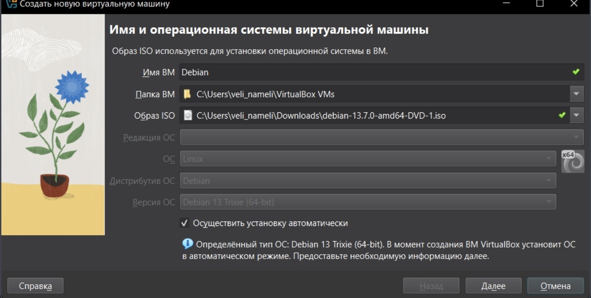
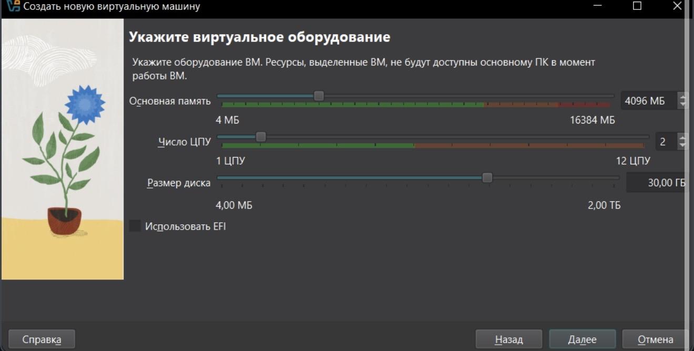
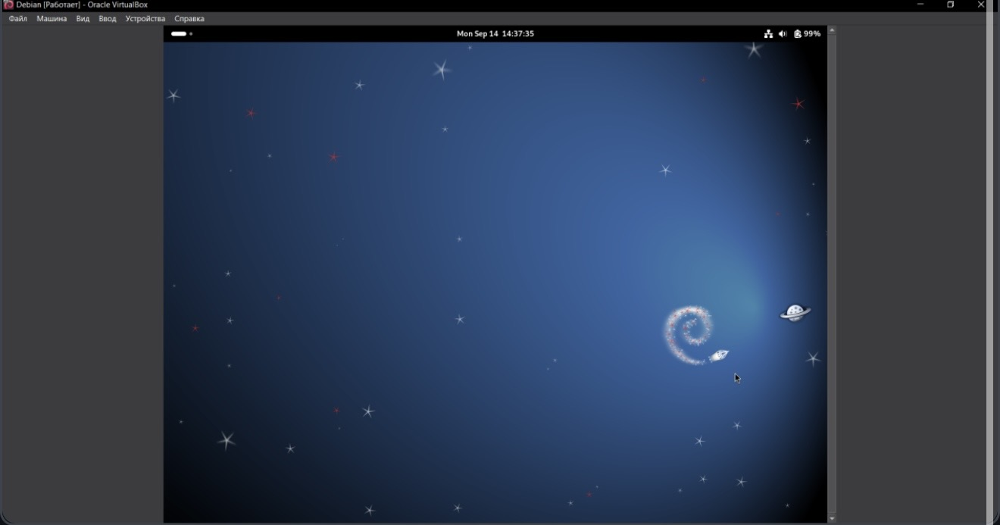
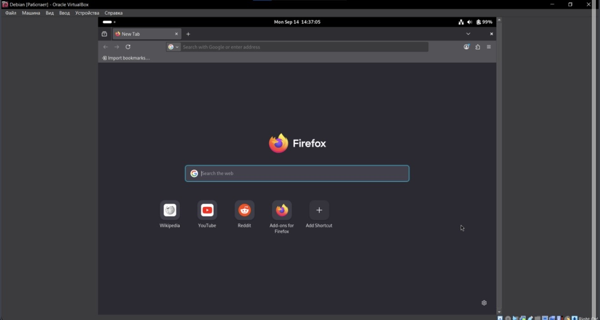
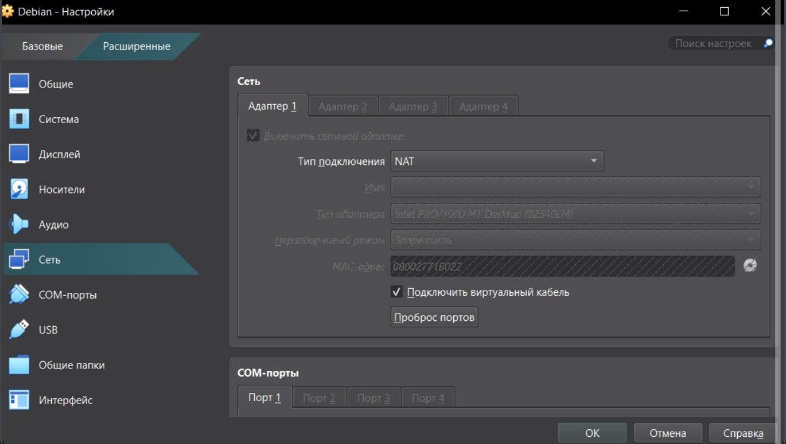
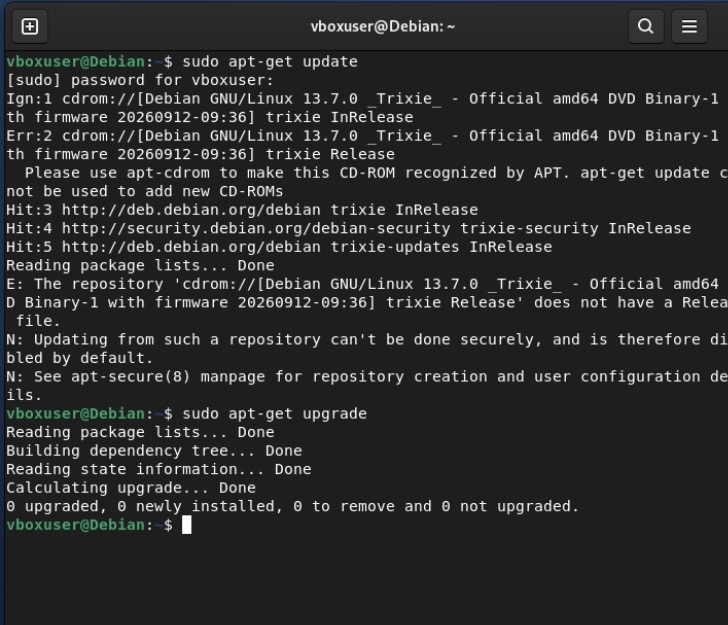
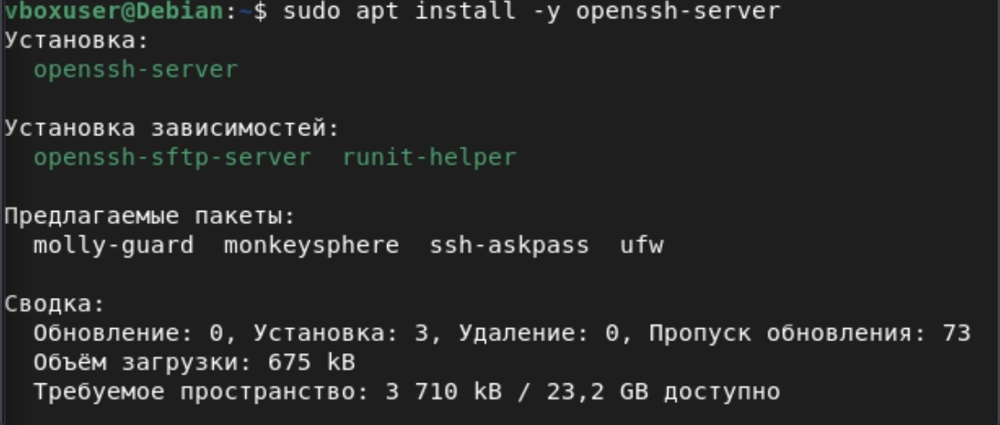
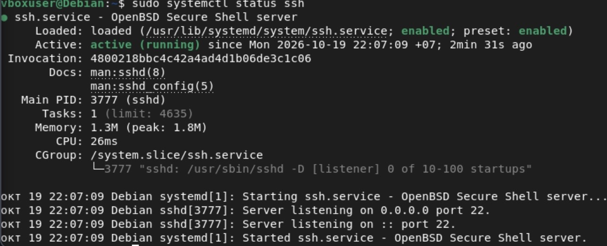
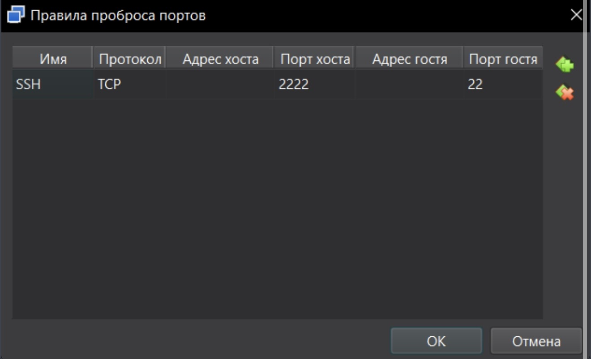

[README (1).md](https://github.com/user-attachments/files/35103351/README.1.md)
# lab1# Лабораторная работа №1. Виртуальная машина с Debian и удалённый доступ по SSH

## Задание

Развернуть в VirtualBox виртуальную машину с Debian, настроить для неё сеть, обновить систему и организовать доступ к ВМ с основного компьютера по протоколу SSH.

## Окружение

| Параметр | Значение |
| --- | --- |
| Хост-система | Windows, PowerShell 5.1 |
| Гипервизор | Oracle VirtualBox |
| Гостевая ОС | Debian 13 «Trixie», amd64 (образ `debian-13.7.0-amd64-DVD-1.iso`) |
| Имя ВМ | `Debian` |
| Пользователь в ВМ | `vboxuser` |

## Параметры виртуальной машины

| Ресурс | Значение |
| --- | --- |
| Оперативная память | 4096 МБ |
| Процессоры | 2 ЦПУ |
| Диск | 30 ГБ |
| EFI | не используется |
| Сеть (адаптер 1) | NAT |

---

## Ход работы

### Шаг 1. Создание ВМ

В мастере создания машины указано имя `Debian` и выбран ISO-образ `debian-13.7.0-amd64-DVD-1.iso`. VirtualBox сам определил тип системы как Debian 13 Trixie (64-bit) и предложил автоматическую установку, которая была оставлена включённой.



Затем выделены ресурсы: 4096 МБ памяти, 2 процессора и диск на 30 ГБ.



### Шаг 2. Проверка установленной системы

После автоматической установки ВМ запустилась и загрузила графический рабочий стол Debian.



Для проверки работоспособности системы и доступа в интернет открыт браузер Firefox.



### Шаг 3. Настройка сети

В настройках ВМ (раздел «Сеть») для адаптера 1 выбран тип подключения **NAT**. При таком режиме гостевая система выходит в интернет через хост, но снаружи напрямую недоступна, поэтому для SSH дальше настраивается проброс портов.



### Шаг 4. Обновление пакетов

В терминале гостевой системы выполнены команды:

```bash
sudo apt-get update
sudo apt-get upgrade
```

`apt-get update` вывел ошибку по источнику `cdrom://`: установочный DVD всё ещё числился в списке репозиториев, а у него нет файла `Release`. Сетевые репозитории (`deb.debian.org`, `security.debian.org`, `trixie-updates`) обработались без проблем, списки пакетов прочитаны. После `apt-get upgrade` обновлять оказалось нечего: `0 upgraded, 0 newly installed, 0 to remove`.



### Шаг 5. Установка SSH-сервера

Установлен пакет `openssh-server` вместе с зависимостями `openssh-sftp-server` и `runit-helper`:

```bash
sudo apt install -y openssh-server
```



Состояние службы проверено командой:

```bash
sudo systemctl status ssh
```

Служба `ssh.service` загружена, включена в автозапуск (`enabled`) и работает (`active (running)`). В журнале видно, что сервер слушает порт 22 на `0.0.0.0` и `::`.



### Шаг 6. Проброс порта

Поскольку ВМ работает через NAT, на хосте создано правило проброса портов («Настройки → Сеть → Дополнительно → Проброс портов»):

| Имя | Протокол | Порт хоста | Порт гостя |
| --- | --- | --- | --- |
| SSH | TCP | 2222 | 22 |

Теперь соединение с `127.0.0.1:2222` на хосте попадает на порт 22 внутри ВМ.



### Шаг 7. Подключение с хоста

В PowerShell на Windows выполнена команда:

```powershell
ssh vboxuser@127.0.0.1 -p 2222
```

Подключение прошло успешно: получено приветствие Debian (ядро Linux 6.12.117, `x86_64`) и открыта командная строка пользователя `vboxuser` на виртуальной машине.


---

## Результат

- Создана ВМ с Debian 13 (4 ГБ ОЗУ, 2 ЦПУ, 30 ГБ диска).
- Для адаптера выбран режим NAT.
- Система обновлена через `apt-get`, замечание по источнику `cdrom://` разобрано.
- Установлен и запущен `openssh-server`, служба добавлена в автозапуск.
- Настроен проброс порта 2222 → 22, и с основного компьютера выполнено подключение к ВМ по SSH.

## Вывод

В работе освоены базовые этапы развёртывания Linux-системы в виртуальной среде: создание ВМ, выбор сетевого режима, обновление пакетов и настройка удалённого доступа. Режим NAT удобен тем, что ВМ получает интернет без дополнительных настроек, а недоступность гостя извне решается пробросом портов, как это сделано для SSH.
